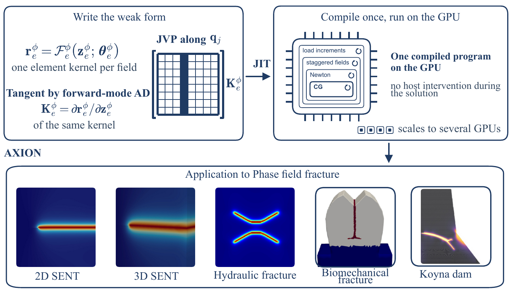

# Axion

**A**utodifferentiable, **X**LA-compiled, **I**mplicit, **O**n-device **N**umerics:
a differentiable, GPU-native finite element framework written in
[JAX](https://github.com/jax-ml/jax), demonstrated on phase-field fracture.

**Website:** [axion-pff.github.io](https://axion-pff.github.io)

This repository contains the framework and every numerical example of

> W. Wang\*, M. Krishnan U.\*, L. Graham-Brady, S. Goswami,
> *Axion: A differentiable, GPU-native finite element framework, demonstrated on
> phase-field fracture.*
>
> \* These authors contributed equally.



*Overview of Axion. Top: each field is defined by one element kernel, whose
tangent follows by forward-mode automatic differentiation; the load, staggered,
Newton and CG loops are compiled into one GPU program that also runs on several
GPUs. Bottom: the phase-field fracture problems solved in this work.*


## Installation

```bash
conda env create -f environment.yml
conda activate axion
```

`environment.yml` installs the CPU build of JAX. On a CUDA machine install the
matching GPU wheel instead, for example `pip install -U "jax[cuda12]"`. The
results of the paper were obtained with JAX 0.10.2 and CUDA 12 in double
precision.

The examples add the repository root to `sys.path` themselves, so no install
step is needed; `pip install -e .` makes `import axion` available elsewhere.


## Repository layout

```
axion/
  elements.py      TRI3 / QUAD4 / TET4 / HEX8 shape functions and quadrature
  mesh.py          mesh container, structured mesh generators
  field.py         one field equation: weak form -> element residuals, tangents by
                   forward-mode AD, residual assembly, operator action
  spectral.py      isotropic tensor functions (spectral split) with a derivative
                   that is valid for repeated eigenvalues
  solvers.py       Newton + Jacobi-CG, projected Jacobi, active-set Newton
  distributed.py   multi-GPU execution by cell decomposition
  io.py            VTU output
assets/            overview figure used in this README
examples/          one folder per numerical example of the paper
tests/             checks of the core on tiny meshes (run on a CPU in seconds)
```

## Numerical examples

| Folder | Paper | Problem | Size [DoF] |
|---|---|---|---|
| `01_sent_2d` | Sec. 4.1.1 | 2D single-edge-notched tension, AT2; uniform and adaptive meshes | 3.08e4 / 1.13e4 |
| `02_sent_3d` | Sec. 4.1.2 | 3D single-edge-notched tension, AT2, HEX8 | 1.46e6 |
| `03_parallel_scaling` | Sec. 4.1.3 | strong and weak scaling of the 3D benchmark on up to 4 GPUs | 1.46e6 - 5.6e6 |
| `04_derivative_verification` | Sec. 4.1.4 | Taylor test of the tangents; forward-mode sensitivities vs. finite differences | 6.8e4 |
| `05_hydraulic_fracture` | Sec. 4.2.1 | three-field hydro-poroelastic fracture, two configurations | 3.80e5 |
| `06_premolar` | Sec. 4.2.2 | 3D premolar, six materials, contact, PF-CZM, TET4 | 6.87e5 |
| `07_koyna_dam` | Sec. 4.2.3 | Koyna gravity dam, uniform mesh, one and two GPUs | 9.6e7 |

Every folder has a README with the settings of the paper, the command to run
and the files that are written. Settings are read from environment variables
(`PFF_*`), so a small test is one line, for example

```bash
cd examples/02_sent_3d
PFF_NX=40 PFF_NY=40 PFF_NZ=4 PFF_NSTEPS=10 python sent_3d.py
```

The solvers are meant for a GPU. On a CPU they run, but the compilation of the
load-loop program alone can take tens of minutes.

## Tests

```bash
python tests/test_core.py          # or: pytest tests
python -m axion.distributed        # multi-GPU kernels on 4 emulated CPU devices
```

## Citation

```bibtex
@article{axion,
  title  = {Axion: A differentiable, GPU-native finite element framework,
            demonstrated on phase-field fracture},
  author = {Wang, Wei and Krishnan U., Meenu and Graham-Brady, Lori and Goswami, Somdatta},
  note   = {W. Wang and M. Krishnan U. contributed equally},
  year   = {2026}
}
```

## License

Axion is released under the [MIT License](LICENSE).
